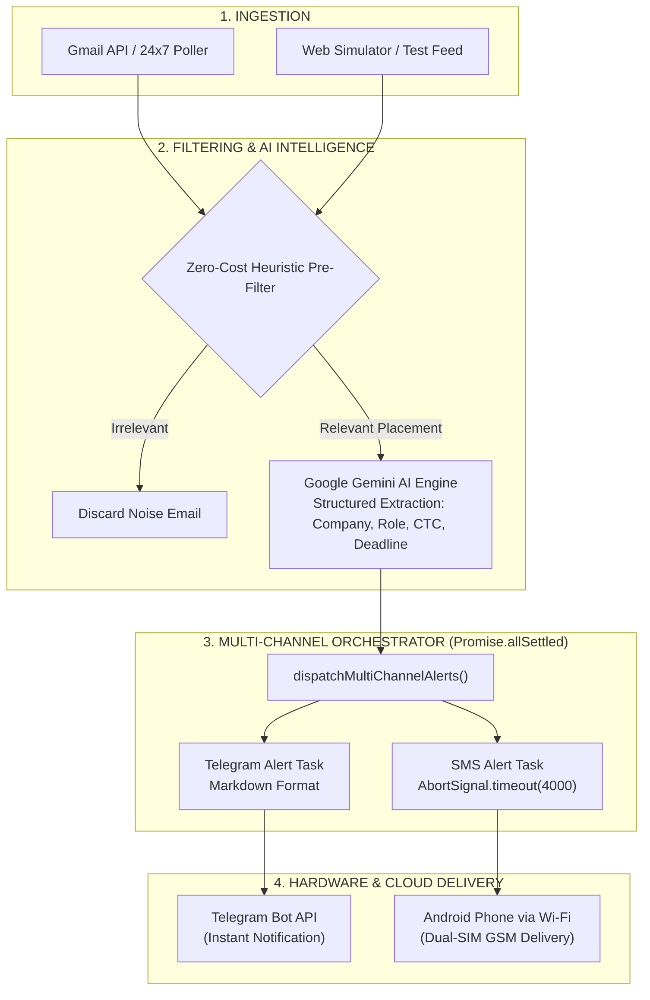

# Mail-E: Campus Recruitment & Placement Notification Engine

> **AI-powered placement alert system built with Node.js, Express.js, Telegram Bot API, and Android SMS Gateway, featuring concurrent dispatch via `Promise.allSettled()` and resilient HTTP timeout controls with `AbortSignal`.**

---

## 📌 Resume Alignment & Feature Verification

| Resume Bullet Point | Code Implementation | Verified Component |
| :--- | :--- | :--- |
| **Node.js, Express.js, REST APIs, Telegram Bot API** | Express REST API server, modular routing, and Telegram Bot API integration | [`src/server.js`](file:///c:/Users/marsh/Downloads/Male%20E/src/server.js), [`src/routes/api.js`](file:///c:/Users/marsh/Downloads/Male%20E/src/routes/api.js), [`src/services/telegram.js`](file:///c:/Users/marsh/Downloads/Male%20E/src/services/telegram.js) |
| **Android SMS Gateway REST API over local Wi-Fi with Basic Authentication & Dual-SIM Routing** | Communicates with an on-device Android SMS Gateway REST API (`http://<ip>:8080/message`) with HTTP Basic Auth, local subnet auto-discovery, and SIM slot configuration (`simNumber: 1` or `2`) | [`LocalOTPServer/server/server.js`](file:///c:/Users/marsh/Downloads/Male%20E/LocalOTPServer/server/server.js), [`src/services/sms.js`](file:///c:/Users/marsh/Downloads/Male%20E/src/services/sms.js) |
| **AbortSignal timeouts to prevent indefinite waits during SMS gateway requests** | Uses `AbortSignal.timeout(4000)` and `AbortSignal.timeout(1500)` on network fetch calls, fast-failing if mobile device drops from Wi-Fi | [`src/services/sms.js`](file:///c:/Users/marsh/Downloads/Male%20E/src/services/sms.js#L54), [`LocalOTPServer/server/server.js`](file:///c:/Users/marsh/Downloads/Male%20E/LocalOTPServer/server/server.js#L74) |
| **Promise.allSettled() for concurrent Telegram and SMS notifications** | Multi-channel orchestrator fires Telegram and SMS alerts concurrently, isolating failures so an SMS timeout never blocks Telegram delivery | [`src/services/notifier.js`](file:///c:/Users/marsh/Downloads/Male%20E/src/services/notifier.js), [`tests/notifier.test.js`](file:///c:/Users/marsh/Downloads/Male%20E/tests/notifier.test.js) |

---

## 🏛️ System Architecture



---

## 🚀 Key Highlights & Architectural Decisions

### 1. Dual Notification Concurrency with `Promise.allSettled()`
- **Why not `Promise.all()`?** `Promise.all()` short-circuits immediately if any single promise rejects. If the student's Android phone temporarily loses Wi-Fi connection, `Promise.all()` would cause the Telegram alert to fail as well.
- **Why not sequential `await`?** A slow or unreachable local SMS gateway could delay or block Telegram messages for up to 10 seconds.
- **The Solution:** Mail-E wraps both Telegram and SMS dispatch in `Promise.allSettled()`. Each delivery result is inspected independently, audit logs are saved to MongoDB, and both platforms are serviced in parallel.

### 2. Local Android SMS Gateway Integration & Dual-SIM Routing
- Uses an Android device running an open-source SMS Gateway REST service.
- Communicates directly over local Wi-Fi or VPN using HTTP Basic Authentication (`Authorization: Basic <base64>`).
- Supports **Dual-SIM card selection**: specifies `simNumber` (1 or 2) in the JSON payload, allowing campus recruitment SMS alerts to be routed through a dedicated SIM plan.

### 3. Fail-Safe Timeout Protection via `AbortSignal.timeout()`
- Mobile devices on Wi-Fi frequently sleep or roam between access points.
- Mail-E guards every outbound request to the local Android gateway with `AbortSignal.timeout(4000)`.
- If the gateway fails to respond within 4 seconds, the request is cleanly aborted and Mail-E falls back to simulation mode without crashing or hanging the server process.

---

## 📂 Repository Structure

```
Mail-E/
├── src/
│   ├── models/             # Mongoose schemas (User, Email, Alert)
│   │   ├── Alert.js        # Audit trail for Telegram & SMS deliveries
│   │   ├── Email.js        # Email records with AI placement metadata
│   │   └── User.js         # Student preferences, phone & Telegram link
│   ├── routes/
│   │   └── api.js          # REST API endpoints (pipeline, dashboard, oauth, sms)
│   ├── services/
│   │   ├── ai.js           # Gemini AI extraction + heuristic pre-filter
│   │   ├── gmail.js        # Google OAuth2 & Gmail inbox fetching
│   │   ├── monitor.js      # 24/7 autonomous polling background worker
│   │   ├── notifier.js     # Promise.allSettled() multi-channel dispatcher
│   │   ├── sms.js          # Android SMS Gateway client with AbortSignal
│   │   └── telegram.js     # Telegram Bot API formatting and dispatch
│   └── server.js           # Express application entrypoint
├── public/                 # Real-time web dashboard & interactive simulator
├── LocalOTPServer/         # Dedicated local Android SMS Gateway bridge & scanner
├── tests/                  # Node.js native test suite
│   └── notifier.test.js    # Concurrency, timeout & formatting tests
├── .env.example            # Environment variables template
├── package.json            # Project metadata & npm scripts
└── README.md               # Documentation & system architecture
```

---

## 🛠️ Setup & Installation

### 1. Prerequisites
- **Node.js**: v18+ (verified on Node.js v25)
- **MongoDB**: Local MongoDB instance (`mongodb://127.0.0.1:27017/mail_e`) or MongoDB Atlas URI

### 2. Configure Environment
Copy `.env.example` to `.env` and fill in your keys:
```bash
cp .env.example .env
```

### 3. Install Dependencies
```bash
npm install
```

### 4. Run Verification Tests
Mail-E uses Node's native test runner (zero external test dependencies required):
```bash
npm test
```

### 5. Start the Application
```bash
# Start Mail-E Server (Port 5000)
npm start

# Development mode with file watching
npm run dev
```

Visit the dashboard in your browser: `http://localhost:5000`

---

## 💬 Interview Preparation: Talking Points

When discussing this project in an interview:

1. **"Why did you choose `Promise.allSettled()` over `Promise.all()`?"**
   > *"I used `Promise.allSettled()` because Telegram and SMS operate across completely different failure domains. Telegram talks to cloud servers over HTTPS, whereas the SMS Gateway communicates with a physical mobile device over local Wi-Fi. If the phone is offline or its IP changes, `Promise.all()` would fail the entire batch and drop the Telegram notification. `Promise.allSettled()` guarantees both execute in parallel and allows me to handle and record the delivery status for each channel independently."*

2. **"How does the Android SMS Gateway work?"**
   > *"Instead of using paid third-party SMS APIs (like Twilio), I integrated an open-source Android SMS Gateway running on an Android smartphone connected to the local Wi-Fi. The Express backend sends POST requests authenticated via HTTP Basic Auth to the phone's REST endpoint (`/message`), specifying the recipient, text, and SIM slot (`simNumber: 2`) to leverage the phone's native SIM plan."*

3. **"How did you prevent requests from hanging if the phone disconnected?"**
   > *"I attached `AbortSignal.timeout(4000)` to the fetch requests. In mobile environments where devices enter low-power sleep or disconnect, standard HTTP requests can hang for minutes before TCP sockets reset. `AbortSignal.timeout` enforces a 4-second strict upper bound, triggering an immediate timeout error and allowing the service to fail gracefully."*

---

## 📄 License
MIT © Marshal Alone
